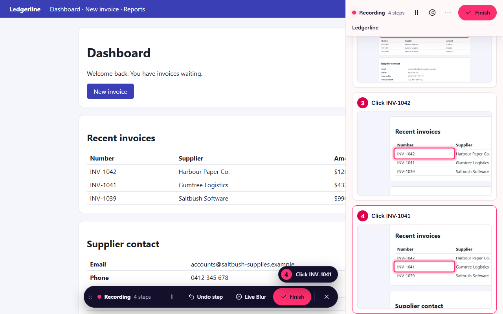
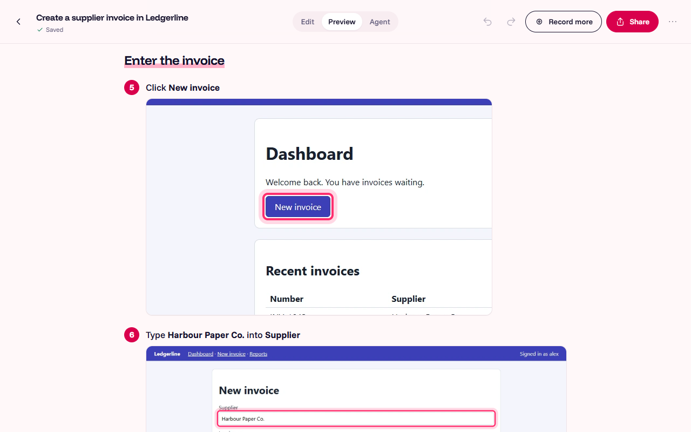

<p align="center"></p>

# ShowSteps

Record a process once and get three things:

- a step-by-step guide with screenshots;
- an on-screen walkthrough that points at each step in the real app;
- a structured procedure that an AI agent or a Playwright script can follow.

ShowSteps works in Chrome and Edge, and in any Windows app through the desktop app. One guide can mix both.



| The finished guide                                                                           | What an agent reads                                                                           |
| -------------------------------------------------------------------------------------------- | --------------------------------------------------------------------------------------------- |
|  |  |

**Local-first and free.** No accounts, no servers, no telemetry, no feature gates, no watermarks. Guides stay on your computer or in a folder you choose, such as one synced with OneDrive or SharePoint. Optional AI features use the AI built into Chrome, on your computer, and are off by default. Passwords, one-time codes and card fields are never stored. Free for non-commercial use.

## Install

The full step-by-step guide, with updating, uninstalling, troubleshooting and keeping everything on your computer, is in **[docs/INSTALL.md](docs/INSTALL.md)**. The short version:

Release files are in `dist/` (build them with `pnpm release`, see [For developers](#for-developers)):

| File                                             | What it is                                                       |
| ------------------------------------------------ | ---------------------------------------------------------------- |
| `showsteps-extension-1.1.0.zip`                  | The browser extension                                            |
| `showsteps-extension-1.1.0-chrome-web-store.zip` | The same extension, packaged for the Chrome Web Store            |
| `ShowSteps-Setup-1.1.0.exe`                      | The Windows desktop app (installs for you only; no admin rights) |
| `SHA256SUMS.txt`                                 | Checksums to verify the downloads                                |

### The browser extension (Chrome or Edge)

Install ShowSteps from the Chrome Web Store: <https://chromewebstore.google.com/detail/hlkihjibgiehjcaemfhfnfcjphgkcnoa>. Chrome keeps it up to date.

Or install it as an unpacked extension (for example where the Web Store is blocked):

1. Unzip `showsteps-extension-1.1.0.zip` to a folder you will keep, for example `Documents\ShowSteps\extension`. Chrome loads it from there each time.
2. Open `chrome://extensions` (in Edge, `edge://extensions`).
3. Turn on **Developer mode** (top right in Chrome; bottom left in Edge).
4. Click **Load unpacked** and choose the unzipped `showsteps-extension-1.1.0` folder.
5. Pin ShowSteps: click the puzzle-piece icon in the toolbar, then the pin next to ShowSteps.

Chrome may show a banner about developer-mode extensions when it starts. That is expected for extensions loaded this way. To update an unpacked copy, unzip the new version over the same folder, then click **↻** on ShowSteps's card in `chrome://extensions`.

ShowSteps asks for website access the first time you record or start a walkthrough, not when it is installed.

### Moving from an earlier build (Trailmark or ABCXYZ)

ShowSteps was briefly called Trailmark, then ABCXYZ. Your guides carry over:

- **Extension:** keep the same folder or unzip the new version over it, then click **↻** on the card in `chrome://extensions`. Guides stay in the browser's storage; old `.trailmark` exports still import.
- **Desktop app:** uninstall the old app first (**Settings → Apps → Trailmark** or **ABCXYZ → Uninstall**), then install ShowSteps. On first start it moves `Documents\Trailmark\Library` to `Documents\ShowSteps\Library` and leaves a note where it was. Nothing else in the old folder is touched.

### The desktop app (Windows 10 or 11)

1. Run `ShowSteps-Setup-1.1.0.exe`. It installs for your Windows user only; no administrator rights are needed. To update, run the new installer over the old version: your library and settings are kept.
2. Windows SmartScreen may say the app is unrecognised, because the installer is not code-signed. Click **More info**, then **Run anyway**.
3. ShowSteps starts and puts an icon in the system tray.

To record Windows apps and web pages into the same guide, open the extension's **Settings** and turn on **Use the ShowSteps desktop app**. The installer has already registered the connection between the two.

To have scheduled runs work after a restart, turn on **Start with Windows** in the desktop app's **Settings**: it then starts in the tray when you sign in, and can open Chrome when a run is due.

To uninstall, use **Settings → Apps** in Windows. It removes the app and the browser connection; your guides stay where they are.

## Where your guides are

| Where                   | Stored in                                                                                                                                                 |
| ----------------------- | --------------------------------------------------------------------------------------------------------------------------------------------------------- |
| Browser extension       | The browser's own storage, on this computer. Use **Export** in the library to save a `.showsteps` file, or keep guides in the desktop library (Settings). |
| Desktop app             | `Documents\ShowSteps\Library`, one folder per guide (`guide.json` plus an `img` folder). You can change this in Settings.                                 |
| Team library (optional) | A folder you share, such as a OneDrive or SharePoint folder: everyone who points ShowSteps at it sees the same guides, and sees who edited them last.     |

Settings → **Delete all ShowSteps data** removes everything the extension keeps in the browser.

## Three things to try first

1. **Record a guide.** Open a web page, click the ShowSteps icon, then **Start capture**. Do the task as usual: each click, entry and choice becomes a step with a screenshot. The side panel shows every step as it is recorded, with its screenshot, and you can delete any of them there. Click **Finish** on the small toolbar or in the side panel. Then tidy the guide in the editor: drag steps, add tips, blur what should not be seen. **Secure Blur** finds emails, phone, card, bank and tax numbers in every screenshot for you to review.
2. **Guide someone through it.** Open the guide and click **Guide Me**. ShowSteps rings each element on the real page and moves on as the person does each step. **Run for me** does the steps itself. It stops for passwords, and for anything that cannot be undone, until you confirm.
3. **Share it.** **Share** makes a PDF, a Word document, Markdown, a single web page, an embed card for SharePoint, or rich text for Teams and Outlook. **Agent Pack** turns the guide into instructions an AI agent can follow, with a Playwright script that replays it.

Desktop apps: press **Ctrl+Alt+R** anywhere to start and finish recording a Windows app.

## Schedules

Run for me can run a guide on its own at set times, for reports, checks and other routine tasks.

**Setting one up.** Open a guide, then **⋯ → Schedule…** (or **Schedule…** on its card in the library). Choose:

- **when:** every day, weekdays, chosen days, a day of the month (the 31st means the last day in shorter months) or a business day of the month (1st to 5th, or last), at a time, with dates to skip such as public holidays;
- **values to type:** the answers Run for me would otherwise ask for. A value can contain a date placeholder, filled in when the run starts: `{today}`, `{yesterday}`, `{tomorrow}`, `{month_start}`, `{month_end}`, `{last_month_start}`, `{last_month_end}` and `{last_business_day}` (the business day before today). **Insert a date** adds one, and the dialog shows what the next run will type;
- **steps to run without stopping:** Run for me normally stops before steps marked to confirm (Submit, Send, Delete…). Tick the ones this schedule may do on its own. Any change to what the guide's steps click or type cancels these approvals, and the schedule then says "Guide changed: check pre-approved steps";
- what to do if Chrome is closed at the time (run it at the next start, or skip it), how long a stopped run waits for you, whether to keep the window open, and whether to check the guide an hour before.

Saving asks Chrome for website access (runs need it) and, optionally, notifications.

**When it runs.** Each run opens its own Chrome window, without taking focus from what you're doing. It stops and tells you with a notification (if you allowed them; otherwise `!` on the toolbar icon shows once the run has ended) when it reaches a confirm step you didn't pre-approve, a step only you can do (a password, say), a page that wants you to sign in ("Sign in, then press Continue"), or a step it can't find. It waits there for you, then ends as stopped. Guides with steps in Windows apps need you at the computer, so they ask "Due. Start now?" with a notification instead of running alone (so allow notifications for those).

**The Schedules page** (library → **Schedules**) lists each schedule's next run and last outcome, with **Run now**, **Edit**, **Delete** and an on/off switch, and a history of the last 20 runs with the values typed and a picture after each step.

**What schedules can't do:** run while the computer is asleep or off, or on a locked screen; do Windows-app steps by themselves; or follow you to another computer. Runs happen while Chrome is open; with the desktop app running (and **Start with Windows** on), Chrome is opened for a run if it's closed.

## What else is in it

- **Editor:** rich step titles, sections, callouts, image steps, crop, zoom, arrows, shapes, badges, blur, bulk blur, undo, version history, branding.
- **Library:** folders, tags, search, trash, duplicate, import and export, comments and reactions, and an Insights page with views and completions.
- **Notes and pins:** sticky notes on any web page, and pinned guides that suggest themselves on the right pages.
- **For agents and automation:** the **Agent** tab in the editor shows what an agent reads for each step:
  - how to find the element;
  - what to type;
  - what should happen next;
  - when to stop and ask.

  **Check every step** dry-runs the guide without clicking anything. If an app changes, **Re-capture this step** fixes one step in place. Every PDF, Word, Markdown and web export also carries the procedure in a machine-readable form.

- **Offline OCR:** text in desktop and pasted screenshots is read on your computer, for Secure Blur and for steps that only have a picture, such as Remote Desktop sessions.

## Privacy

ShowSteps makes no network requests of its own: its fonts and icons are bundled, a test checks that its pages load nothing from the internet, and the desktop app blocks every web request from its own windows. The extension never uses Chrome Sync storage, so nothing is copied to your Google account. Schedules, run logs and their screenshots stay in the extension's own storage on this computer. The extension talks to the desktop app over Windows native messaging on the same computer. Exports are files you choose where to put. The OCR engine and its English model ship inside both apps, so nothing is downloaded at run time.

## For developers

Requirements:

- Windows 10 or 11, Node.js 22 LTS, pnpm 10 and git.
- No .NET SDK: the desktop helpers compile with the C# compiler built into Windows.

```bash
pnpm install
pnpm build
pnpm test
```

End-to-end tests. The first command downloads Chromium into `node_modules`:

```bash
pnpm setup:browsers
```

```bash
pnpm e2e
```

The desktop tests drive the real mouse and keyboard, only inside a Notepad window they open. Leave the computer alone while they run:

```bash
pnpm e2e:desktop
```

Release files (the extension zip and the installer, into `dist/`):

```bash
pnpm release
```

The demo web app used by the tests:

```bash
pnpm demo
```

Where to read more:

- [docs/DEVELOPING.md](docs/DEVELOPING.md): repo layout and conventions.
- [PARITY.md](PARITY.md): the feature checklist.
- [docs/DECISIONS.md](docs/DECISIONS.md): the defaults chosen.
- [docs/MANUAL_TESTS.md](docs/MANUAL_TESTS.md): checks to do by hand.
- [AGENTS.md](AGENTS.md): notes for coding agents (GitHub Copilot reads `.github/copilot-instructions.md`, which points there).
- [docs/design/POLISH_REPORT.md](docs/design/POLISH_REPORT.md): the ShowSteps design, before and after.

Brand files (logo, wordmark, patterns) are in `brand/`; `pnpm brand` regenerates every icon from them.

## Licence

ShowSteps is **free for personal and other non-commercial use** under the [PolyForm Noncommercial License 1.0.0](LICENSE). You may download, use, study and change it, and share it with others for non-commercial purposes. You may not use it, or anything made from it, for commercial purposes: for example selling it, charging for it, bundling it into a paid product or service, or using it in the work of a business. Charities, schools, public research organisations and government bodies may use it. For commercial use, contact the author for a separate licence.

ShowSteps uses the Funnel Sans and Funnel Display fonts (and, for the logo, Hanken Grotesk and Instrument Serif) under the SIL Open Font License 1.1, and open-source packages under their own licences: see `licenses/NOTICES.txt` in either app (`pnpm notices` regenerates it).

"ShowSteps" and its logo identify this project. The name and logo are not covered by the licence: a fork that changes the software should use its own name.
